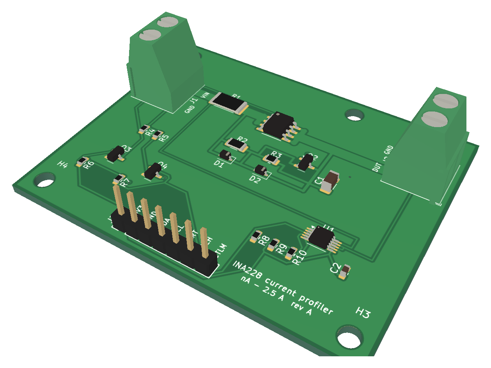
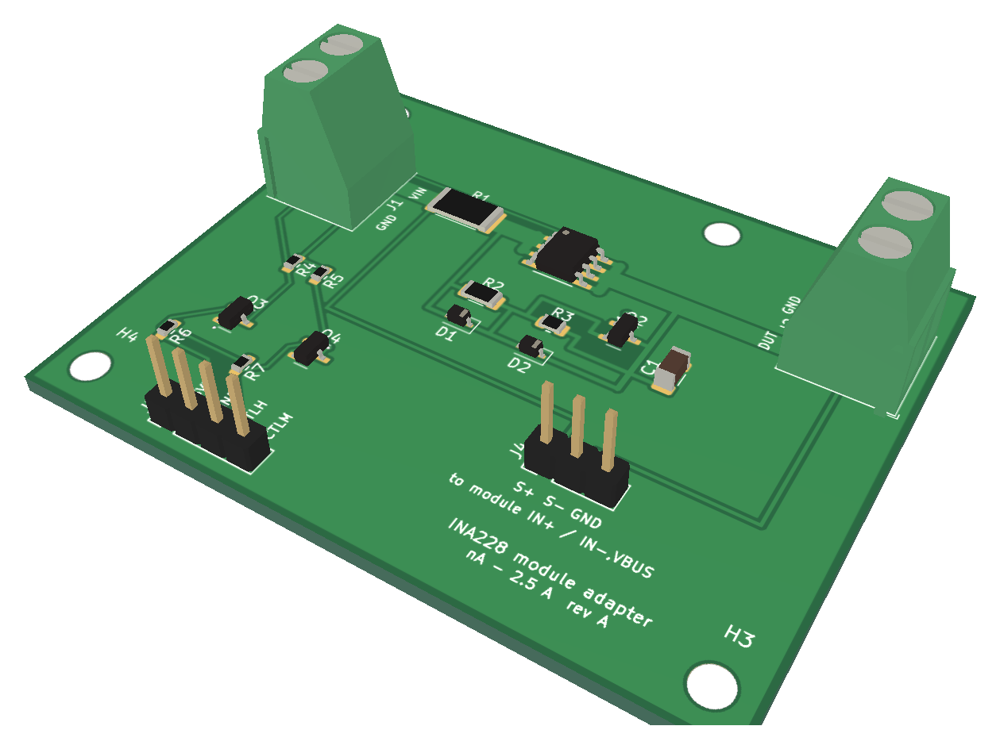
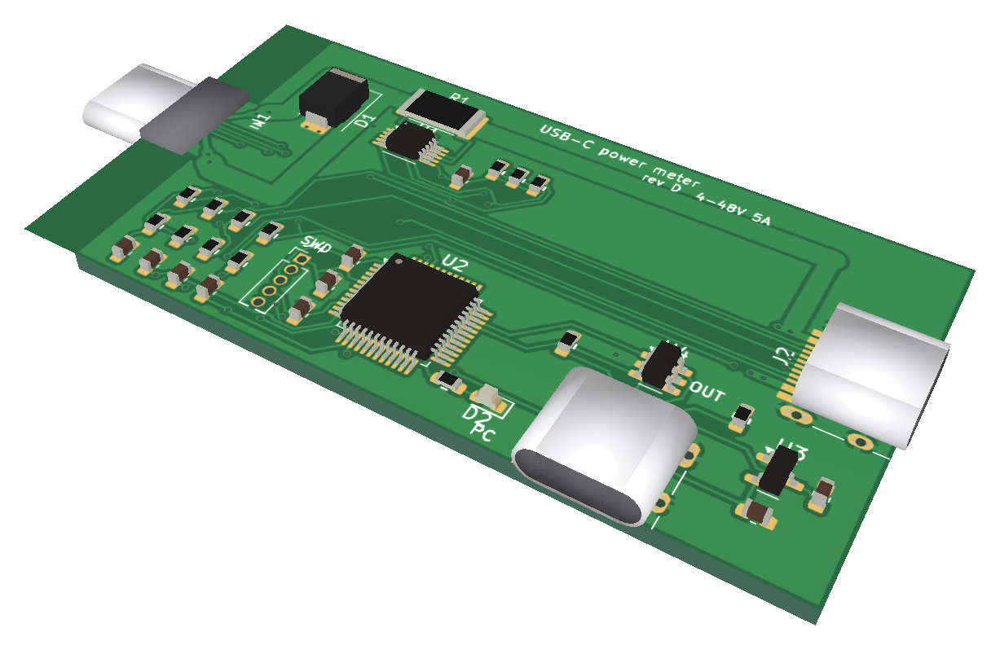
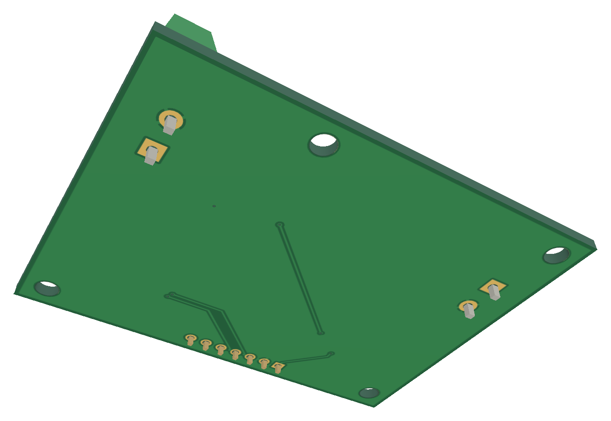
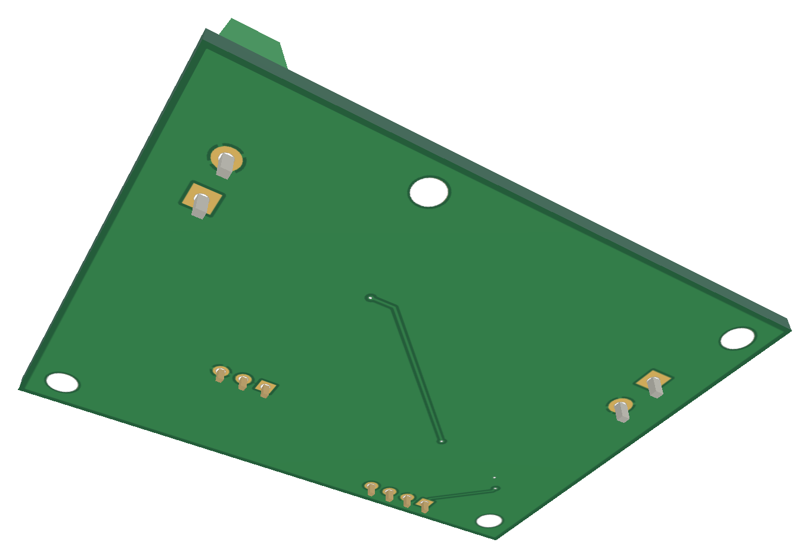
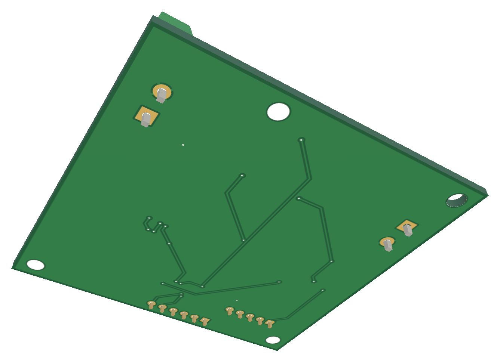
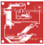

# INA228 auto-ranging current profiler (nA – 2.5 A)

A small open-hardware current meter for profiling microcontrollers such as the STM32, from **deep sleep (tens of nA)** up to **full load (2.5 A)**. It uses a TI **INA228** 20-bit power monitor, three series shunt resistors, and two P-MOSFETs that switch the measurement range.

There are three variants built from the same range-switching core:

| | A: integrated | B: module adapter | C: smart (on-board ranging) |
|---|---|---|---|
| |  |  |  |
| INA228 | on the board | off-the-shelf breakout (SparkFun or Adafruit), its own shunt disabled | on the board |
| Who switches ranges | your logger MCU | your logger MCU | **the board itself** (STM32G030 + fast comparator) |
| What the host gets | raw INA228 + CTL lines | raw INA228 + CTL lines | **one number:** current in A, voltage, charge, energy |
| Host header | 3V3 GND SDA SCL ALERT CTL_H CTL_M | 3V3 GND CTL_H CTL_M (I2C via the module's Qwiic) | 3V3 GND SDA SCL TX RX (I2C 0x48 or CSV over UART) |
| Board | 62 × 49 mm | 62 × 49 mm | 62 × 62 mm |
| Files | [`hardware/`](hardware) | [`hardware-module/`](hardware-module) · [notes](docs/module.md) | [`hardware-smart/`](hardware-smart) · [notes](docs/smart.md) · [firmware](firmware/smart) |

- **A:** the cleanest build when you want to write the ranging yourself.
- **B:** if you already have an INA228 breakout or don't want to solder a 0.5 mm-pitch VSSOP.
- **C:** if the host should just read a current. The three ranges then look like a single one from nA to 2.5 A.

### Rev D: USB-C power meter (4–48 V, 5 A)



A separate in-line tester for chargers, phones and power banks, built on the same INA228:

- **Hardware:** a USB-C plug (J1) goes into the charger, the device's cable goes into the receptacle (J2), and a second USB-C port (J3) goes to the PC.
- **Measures:** V, A, W, mAh and mWh, plus the CC1/CC2/D+/D− line voltages (Type-C current advertisement, VCONN, QC/Apple/BC1.2 levels).
- **No display:** everything goes to the PC over USB as a serial port, for an app to plot and report.
- **Range:** 10 mΩ shunt. ±4 A in 7.8 µA steps, switching automatically to ±16 A above 3.8 A. Board limit 5 A.
- **USB PD 3.1 EPR (48 V):** the INA228 (85 V) and the 51 V TVS cover it. The plug is rated 20 V, see [docs/usb.md](docs/usb.md#will-usb-pd-31-48-v-damage-it).
- **Pass-through:** CC1, CC2, D+, D−, SBU1 and SBU2 go straight through, so PD/QC negotiation and e-marked cables work as with the cable alone.
- **Programming:** STM32G0B1 with TinyUSB, flashed over USB (DFU). No programmer needed.
- **PC app:** https://kourosh.site/ina228-current-profiler/app/ opens in Chrome or Edge and talks to the meter over Web Serial, with nothing to install. It shows live V/A/W charts, decodes what the charger negotiates, and builds a charge-session report: phases, voltage levels, charger + cable resistance, and an estimate of the battery's capacity and health. It also has a demo session and opens CSV logs. Source: [`docs/app/index.html`](docs/app/index.html).
- **Files:** [`hardware-usb/`](hardware-usb) · [notes](docs/usb.md) · [firmware](firmware/usb)

### Why not just change the breakout's shunt?

A single shunt only moves the measurement window; it does not widen it:

| Single shunt | Full scale (±40.96 mV range) | 1 LSB | Good for |
|---|---|---|---|
| 15 mΩ (stock) | 2.7 A | ≈ 5 µA | run mode |
| 1 Ω | 41 mA | ≈ 78 nA | light run, stop modes |
| 1 kΩ | 41 µA | ≈ 78 pA | deep sleep only |

Measuring an STM32 from deep sleep (tens of nA) up to full load (2.5 A) takes switched ranges. Variant B adds them in front of a ready-made breakout.

### Variant C in short

- **One value out:**
  - I2C: read a `float` at register 0x04 of address 0x48.
  - UART: each line is `t_us,current_A,voltage_V,range`.
  - The board also integrates **charge and energy** at the full conversion rate. Average current between two reads = Δcharge / Δtime, exact even with slow polling.
- **Fast up-ranging in hardware:**
  - A TLV7021 comparator watches the drop across the shunts (threshold ≈ 32 mV).
  - When the DUT wakes up, it interrupts the MCU, which steps up a range in about 1 µs.
  - Down-ranging is done in firmware with hysteresis, so ranges never oscillate.
- **Supply:** VIN 1.8–5.5 V. 3V3 for the board comes from the host header.
- **Programming:** SWD pads (J4) for an ST-Link, such as the one on a Nucleo board.
- Details: [docs/smart.md](docs/smart.md) · firmware and register map: [firmware/smart](firmware/smart)

### Variant B in short

- **The adapter carries the ranging**: the shunts, range MOSFETs and gate drivers are on the adapter. The INA228 is on the breakout.
- **J4 is a Kelvin sense output**:
  - S+ is taken from the R1 pad, S− from the DUT terminal.
  - Wire S+ to the module's IN+, S− to IN− (and VBUS), GND to GND.
  - **No load current flows through the module.**
- **I2C:** the module's Qwiic connector goes to the logger. The adapter's J3 has only `3V3, GND, CTL_H, CTL_M`.

> **⚠ Disable the module's own shunt first.** Otherwise it sits directly across S+ and S−, almost all of the current goes through the sense wires, and every range reads wrong.
> - **SparkFun Current Sensor INA228 (SEN-31438):** open the **SHUNT** jumper on the back.
> - **Adafruit INA228 (5832):** remove the 15 mΩ shunt resistor.
>
> Before wiring, measure the resistance between the module's IN+ and IN−. It must be high (hundreds of kΩ or more), not milliohms.

Keep the S+/S− wires short (under 15 cm) and twisted, and away from the J1–J2 current path. Full preparation and wiring notes: [docs/module.md](docs/module.md).

## 3D models

**Interactive viewer:** https://kourosh.site/ina228-current-profiler/viewer (variant C directly: [`?v=smart`](https://kourosh.site/ina228-current-profiler/viewer/index.html?v=smart), rev D: [`?v=usb`](https://kourosh.site/ina228-current-profiler/viewer/index.html?v=usb)). Turn the board, zoom, switch between the variants, and point at a part to see its name and value.

**STL in GitHub's own 3D viewer:** click [`hardware/3d/current_meter.stl`](hardware/3d/current_meter.stl), [`hardware-module/3d/current_adapter.stl`](hardware-module/3d/current_adapter.stl) [`hardware-smart/3d/current_smart.stl`](hardware-smart/3d/current_smart.stl) or [`hardware-usb/3d/current_usb.stl`](hardware-usb/3d/current_usb.stl) and GitHub shows a rotatable model. It has one colour and no copper or silkscreen.

| Variant A, bottom | Variant B, bottom | Variant C, bottom |
|---|---|---|
|  |  |  |

- **STEP** (`hardware*/3d/*.step`): opens in any CAD tool (FreeCAD, Fusion, SolidWorks) for enclosure design.
- **STL** (`hardware*/3d/*.stl`): one-colour mesh in mm, shown by GitHub and accepted by any slicer or mesh tool.
- **GLB** (`hardware*/3d/*.glb`): the same model with copper, solder mask and silkscreen from the real board layers. Opens in any glTF viewer (Blender, online glTF viewers).
- **Parts:** 3D bodies come from the KiCad 3D library. Rev D's USB-C connectors have no library model, so `tools/add_usb_bodies.py` adds simple bodies for them.
- **Terminals:** the wire entries of J1 and J2 face the board edge on both variants.

## How it works

```
VIN ──R1 50mΩ──●──R2 1Ω──●──R3 1kΩ──● DUT_VDD ──► STM32 (DUT)
               │ NODE_A  │ NODE_B   │
               │         └── Q2 ────┤   Q2 bypasses R3        (mid range)
               └────────── Q1 ──────┘   Q1 bypasses R2 + R3   (high range)

INA228: IN+ = VIN (R1 pad), IN- = DUT_VDD (DUT terminal)  → always measures the whole chain
```

| Range | FETs on | Total shunt | INA228 ADCRANGE | Full scale | Useful span |
|---|---|---|---|---|---|
| L | none | ≈ 1001 Ω | 1 (±40.96 mV) | ≈ 40 µA | ~5 nA – 35 µA |
| M | Q2 | ≈ 1.05 Ω | 1 (±40.96 mV) | ≈ 38 mA | 20 µA – 35 mA |
| H | Q1 | ≈ 60 mΩ | 0 (±163.84 mV) | > 2.5 A | 20 mA – 2.5 A |

Q1 bypasses R2 and R3 together, so at high current only **one** MOSFET's Rds(on) sits in the path.

See [docs/design.md](docs/design.md) for the design notes: wake-up transients, leakage, calibration and firmware strategy.

## PCB

| Variant A, top | Variant B, top | Variant C, top |
|---|---|---|
|  |  |  |

- **Board:** 62 × 49 mm (C: 62 × 62 mm), 2 layers, 1 oz copper, 4 × M3 holes, GND pour on both layers.
- **Terminals:** 5.08 mm screw terminals for VIN (J1) and DUT (J2). Both wire entries face the board edge.
- **Hand-routed nets:** the measurement-critical nets (VIN, NODE_A, NODE_B, DUT_VDD) are routed in `tools/gen_pcb.py` and locked:
  - The 2.5 A path is 2 mm wide.
  - IN+ / S+ is a Kelvin trace from the R1 pad.
  - IN− / S− is a Kelvin trace from the DUT terminal.
  - The gate pull-ups tap VIN upstream of the sense point.
  - Variant C: the comparator's VIN feed and its IN+ line from DUT_VDD are hand-routed too.
- **Autorouted nets:** everything else is routed with Freerouting.
- **Checks:** DRC is clean, nothing is unconnected, and every footprint is linked to its schematic symbol.
- **Fabrication:** `fab/gerbers.zip` (Gerbers + drill) and `fab/positions_top.csv` in each hardware folder.
- **3D:** `3d/*.step` for any CAD tool, plus `3d/*.glb` with copper, mask and silkscreen textures for any glTF viewer (Blender, online glTF viewers).

## Ordering assembled boards

Variants A and C and rev D are ready to order fully assembled from JLCPCB: Gerbers, BOM with LCSC part numbers, and the pick-and-place file are in [`hardware/jlcpcb/`](hardware/jlcpcb), [`hardware-smart/jlcpcb/`](hardware-smart/jlcpcb) and [`hardware-usb/jlcpcb/`](hardware-usb/jlcpcb). Settings, part list, fallback parts and what to check in the placement preview are in [docs/ordering.md](docs/ordering.md).

## Repository layout

```
hardware/            variant A: KiCad project, fab/, 3d/, jlcpcb/, schematic.pdf, BOM.csv
hardware-module/     variant B: same structure
hardware-smart/      variant C: same structure
hardware-usb/        rev D (USB-C power meter): same structure
docs/
  design.md          design notes and calibration procedure
  module.md          variant B: preparing and wiring the breakout
  smart.md           variant C: on-board ranging, comparator, sample rate
  usb.md             rev D: USB-C power meter, PD 3.1 limits, pass-through, board notes
  ordering.md        ordering variants A, C and rev D assembled (JLCPCB)
  integrated/ module/ smart/ usb/  schematic, PCB and 3D renders
  viewer/            interactive 3D viewer (served at kourosh.site)
  app/               rev D PC app: live charts and charge reports in the browser (Web Serial)
firmware/
  smart/             variant C firmware (STM32G030, bare metal) + host scripts for Pi / PC
  usb/               rev D firmware (STM32G0B1, TinyUSB CDC) + host/meter.py
tools/
  gen_schematic.py   schematic, symbol library and BOM   (arg: integrated | module | smart | usb)
  gen_pcb.py         placement + hand-routing of the critical nets (variants A-C)
  gen_pcb_usb.py     rev D placement, board outline with the plug paddle, 5 A paths and Kelvin taps
  route.py           Freerouting for the remaining nets, GND pours, DRC-gated retries
  step2glb.py        STEP → GLB with colours (OpenCascade)
  make_3d.py         adds copper/mask/silk textures to the GLB
  render_3d.py       PNG renders of the GLB
  add_usb_bodies.py  simple 3D bodies for rev D's USB-C connectors
  glb2stl.py         one-colour STL for GitHub's 3D viewer
  build_pcb.sh       runs all of the above and exports fab files
  jlcpcb.py          JLCPCB BOM + CPL for assembled boards   (arg: integrated | smart | usb)
```

## Logger connector (J3, variant A)

| Pin | Signal | Notes |
|---|---|---|
| 1 | +3V3 | supplies the INA228 |
| 2 | GND | common ground with the DUT |
| 3 | SDA | INA228 at I2C address 0x40 |
| 4 | SCL | |
| 5 | ALERT | open drain; use as an interrupt for fast up-ranging |
| 6 | CTL_H | HIGH = Q1 on (high range). Pulled HIGH at reset |
| 7 | CTL_M | HIGH = Q2 on (mid range). Pulled HIGH at reset |

Variant B's J3 is pins 1, 2, 6 and 7 of this list, in that order. Its J4 is S+, S−, GND.

Variant C's J3 is `3V3, GND, SDA, SCL, TX, RX`: I2C slave 0x48 and UART 921600 8N1. See [firmware/smart](firmware/smart#host-interfaces-j3).

## Status

- [x] Concept and schematic
- [x] PCB layout, variants A and B (rev A) and C (rev C), not yet fabricated
- [x] 3D models
- [x] Variant C firmware with auto-ranging (compiles; not yet run on hardware)
- [x] Rev D (USB-C power meter): schematic, PCB, 3D, JLCPCB files, firmware (compiles; not yet fabricated or run)
- [x] PC app for rev D (browser, Web Serial): live plots, protocol decoding, charge-session report (tested with the built-in demo, not yet with a board)
- [ ] Logger firmware for variants A/B
- [ ] Calibration and validation against a reference meter

## Rebuilding

The schematics, PCBs and 3D files are all generated from scripts:

```sh
# needs KiCad 7+ with footprint and 3D libraries, Java, xvfb-run and the Freerouting 1.9 jar;
# the 3D step also needs: pip install cadquery-ocp trimesh pillow pyrender "pyopengl==3.1.7"
tools/build_pcb.sh /path/to/freerouting-1.9.0.jar integrated
tools/build_pcb.sh /path/to/freerouting-1.9.0.jar module
tools/build_pcb.sh /path/to/freerouting-1.9.0.jar smart
tools/build_pcb.sh /path/to/freerouting-1.9.0.jar usb
python3 tools/jlcpcb.py smart          # JLCPCB BOM + CPL for variant C
python3 tools/jlcpcb.py usb            # ... and for rev D
make -C firmware/smart                 # variant C firmware (arm-none-eabi-gcc)
make -C firmware/usb                   # rev D firmware (fetches TinyUSB 0.18.0 with git)
```

Freerouting is not deterministic, so the low-current routing can differ between runs. `route.py` retries until the board is fully connected with no copper DRC errors. Run DRC in KiCad once more after rebuilding.

## License

MIT, see [LICENSE](LICENSE).
