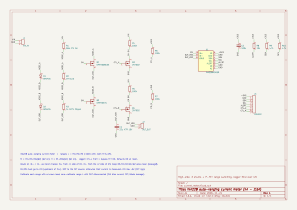

# INA228 auto-ranging current profiler (nA – 2.5 A)

A small, open hardware current meter for profiling microcontrollers such as the STM32, from **deep sleep (tens of nA)** up to **full load (2.5 A)**. It is built from a TI **INA228** 20-bit power monitor, three series shunt resistors and two P-MOSFETs that switch the measurement range. A separate **logger MCU** reads the INA228 over I2C, switches ranges and stores the data.



## How it works

```
VIN ──R1 50mΩ──●──R2 1Ω──●──R3 1kΩ──● DUT_VDD ──► STM32 (DUT)
               │ NODE_A  │ NODE_B   │
               │         └── Q2 ────┤   Q2 bypasses R3        (mid range)
               └────────── Q1 ──────┘   Q1 bypasses R2 + R3   (high range)

INA228: IN+ = VIN, IN- = DUT_VDD  → always measures the whole chain
```

| Range | FETs on | Total shunt | INA228 ADCRANGE | Full scale | Useful span |
|---|---|---|---|---|---|
| L | none | ≈ 1001 Ω | 1 (±40.96 mV) | ≈ 40 µA | ~5 nA – 35 µA |
| M | Q2 | ≈ 1.05 Ω | 1 (±40.96 mV) | ≈ 38 mA | 20 µA – 35 mA |
| H | Q1 | ≈ 60 mΩ | 0 (±163.84 mV) | > 2.5 A | 20 mA – 2.5 A |

Because Q1 bypasses R2 and R3 together, only **one** MOSFET's Rds(on) sits in the path at high current.

## PCB

| Top | Bottom |
|---|---|
|  |  |

- 62 × 49 mm, 2 layers, 1 oz copper, 4 × M3 mounting holes. Solid GND pour on both layers.
- **VIN / DUT:** 5.08 mm screw terminals (J1 / J2).
- **Logger:** 1×7 2.54 mm header (J3).
- **Hand-routed nets:** the measurement-critical nets (VIN, NODE_A, NODE_B, DUT_VDD) are routed by hand in `tools/gen_pcb.py` and locked:
  - The 2.5 A path is 2 mm wide.
  - IN+ is a Kelvin trace from the R1 pad.
  - IN- is a Kelvin trace from the DUT terminal.
  - The gate pull-ups tap VIN upstream of the sense point.
- **Autorouted nets:** everything else is routed with Freerouting.
- **Fabrication files:** `hardware/fab/gerbers.zip` (Gerbers + drill, ready to upload to a PCB fab) and `hardware/fab/positions_top.csv` (pick-and-place).

See [docs/design.md](docs/design.md) for the design notes: wake-up transients, leakage, calibration and firmware strategy.

## Repository layout

```
hardware/
  kicad/            KiCad 7 project: schematic + PCB (opens in KiCad 8/9)
  fab/              Gerbers, drill and pick-and-place files
  schematic.pdf     printable schematic
  BOM.csv           bill of materials
docs/
  design.md         design notes and calibration procedure
  schematic.svg
firmware/           logger firmware (planned)
tools/
  gen_schematic.py  regenerates the KiCad schematic, symbol library and BOM
  gen_pcb.py        PCB placement and hand-routing of the critical nets
  route.py          Freerouting for the remaining nets, GND pours
  build_pcb.sh      runs everything and exports the fab files
```

## Logger connector (J3)

| Pin | Signal | Notes |
|---|---|---|
| 1 | +3V3 | supplies the INA228 |
| 2 | GND | common ground with the DUT |
| 3 | SDA | INA228 at I2C address 0x40 |
| 4 | SCL | |
| 5 | ALERT | open drain; use as an interrupt for fast up-ranging |
| 6 | CTL_H | HIGH = Q1 on (high range). Pulled HIGH at reset |
| 7 | CTL_M | HIGH = Q2 on (mid range). Pulled HIGH at reset |

## Status

- [x] Concept and schematic
- [x] PCB layout (rev A, not yet fabricated)
- [ ] Logger firmware with auto-ranging
- [ ] Calibration and validation against a reference meter

## License

MIT, see [LICENSE](LICENSE).

## Rebuilding

The schematic and PCB are generated from scripts, so the design can be reproduced or changed in code:

```sh
# needs KiCad 7+, Java, xvfb-run and the Freerouting 1.9 jar
tools/build_pcb.sh /path/to/freerouting-1.9.0.jar
```

Freerouting is not deterministic, so the low-current routing can differ between runs. `route.py` retries until every net is connected. Always run DRC in KiCad after rebuilding.
