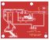

# INA228 auto-ranging current profiler (nA – 2.5 A)

A small open-hardware current meter for profiling microcontrollers such as the STM32, from **deep sleep (tens of nA)** up to **full load (2.5 A)**. It uses a TI **INA228** 20-bit power monitor, three series shunt resistors, and two P-MOSFETs that switch the measurement range. A separate **logger MCU** reads the INA228 over I2C, switches ranges and stores the data.

There are two variants built from the same range-switching core:

| | A: integrated | B: module adapter |
|---|---|---|
| |  |  |
| INA228 | on the board | off-the-shelf breakout (SparkFun or Adafruit), its own shunt disabled |
| Sense path | Kelvin traces to U1 | Kelvin sense header J4 → module IN+ / IN− |
| Logger header | 3V3 GND SDA SCL ALERT CTL_H CTL_M | 3V3 GND CTL_H CTL_M (I2C via the module's Qwiic) |
| Files | [`hardware/`](hardware) | [`hardware-module/`](hardware-module) · [notes](docs/module.md) |

Choose **A** for the cleanest, smallest-error build. Choose **B** if you already have an INA228 breakout or don't want to solder a 0.5 mm-pitch VSSOP.

## How it works

```
VIN ──R1 50mΩ──●──R2 1Ω──●──R3 1kΩ──● DUT_VDD ──► STM32 (DUT)
               │ NODE_A  │ NODE_B   │
               │         └── Q2 ────┤   Q2 bypasses R3        (mid range)
               └────────── Q1 ──────┘   Q1 bypasses R2 + R3   (high range)

INA228: IN+ = VIN (R1 pad), IN- = DUT_VDD (DUT terminal)  → always measures the whole chain
```

| Range | FETs on | Total shunt | INA228 ADCRANGE | Full scale | Useful span |
|---|---|---|---|---|---|
| L | none | ≈ 1001 Ω | 1 (±40.96 mV) | ≈ 40 µA | ~5 nA – 35 µA |
| M | Q2 | ≈ 1.05 Ω | 1 (±40.96 mV) | ≈ 38 mA | 20 µA – 35 mA |
| H | Q1 | ≈ 60 mΩ | 0 (±163.84 mV) | > 2.5 A | 20 mA – 2.5 A |

Q1 bypasses R2 and R3 together, so at high current only **one** MOSFET's Rds(on) sits in the path.

See [docs/design.md](docs/design.md) for the design notes: wake-up transients, leakage, calibration and firmware strategy.

## PCB (both variants)

| Variant A, top | Variant B, top |
|---|---|
|  |  |

- **Board:** 62 × 49 mm, 2 layers, 1 oz copper, 4 × M3 holes, GND pour on both layers.
- **Terminals:** 5.08 mm screw terminals for VIN (J1) and DUT (J2). Both wire entries face the board edge.
- **Hand-routed nets:** the measurement-critical nets (VIN, NODE_A, NODE_B, DUT_VDD) are routed in `tools/gen_pcb.py` and locked:
  - The 2.5 A path is 2 mm wide.
  - IN+ / S+ is a Kelvin trace from the R1 pad.
  - IN− / S− is a Kelvin trace from the DUT terminal.
  - The gate pull-ups tap VIN upstream of the sense point.
- **Autorouted nets:** everything else is routed with Freerouting.
- **Checks:** DRC is clean, nothing is unconnected, and every footprint is linked to its schematic symbol.
- **Fabrication:** `fab/gerbers.zip` (Gerbers + drill) and `fab/positions_top.csv` in each hardware folder.
- **3D:** `3d/*.step` for any CAD tool, plus `3d/*.glb` with copper, mask and silkscreen textures for any glTF viewer (Blender, online glTF viewers).

## Repository layout

```
hardware/            variant A: KiCad project, fab/, 3d/, schematic.pdf, BOM.csv
hardware-module/     variant B: same structure
docs/
  design.md          design notes and calibration procedure
  module.md          variant B: preparing and wiring the breakout
  integrated/ module/  schematic, PCB and 3D renders
firmware/            logger firmware (planned)
tools/
  gen_schematic.py   schematic, symbol library and BOM   (arg: integrated | module)
  gen_pcb.py         placement + hand-routing of the critical nets
  route.py           Freerouting for the remaining nets, GND pours, DRC-gated retries
  step2glb.py        STEP → GLB with colours (OpenCascade)
  make_3d.py         adds copper/mask/silk textures to the GLB
  render_3d.py       PNG renders of the GLB
  build_pcb.sh       runs all of the above and exports fab files
```

## Logger connector (J3, variant A)

| Pin | Signal | Notes |
|---|---|---|
| 1 | +3V3 | supplies the INA228 |
| 2 | GND | common ground with the DUT |
| 3 | SDA | INA228 at I2C address 0x40 |
| 4 | SCL | |
| 5 | ALERT | open drain; use as an interrupt for fast up-ranging |
| 6 | CTL_H | HIGH = Q1 on (high range). Pulled HIGH at reset |
| 7 | CTL_M | HIGH = Q2 on (mid range). Pulled HIGH at reset |

Variant B's J3 is pins 1, 2, 6 and 7 of this list, in that order. Its J4 is S+, S−, GND.

## Status

- [x] Concept and schematic
- [x] PCB layout, both variants (rev A, not yet fabricated)
- [x] 3D models
- [ ] Logger firmware with auto-ranging
- [ ] Calibration and validation against a reference meter

## Rebuilding

The schematics, PCBs and 3D files are all generated from scripts:

```sh
# needs KiCad 7+ with footprint and 3D libraries, Java, xvfb-run and the Freerouting 1.9 jar;
# the 3D step also needs: pip install cadquery-ocp trimesh pillow pyrender "pyopengl==3.1.7"
tools/build_pcb.sh /path/to/freerouting-1.9.0.jar integrated
tools/build_pcb.sh /path/to/freerouting-1.9.0.jar module
```

Freerouting is not deterministic, so the low-current routing can differ between runs. `route.py` retries until the board is fully connected with no copper DRC errors. Run DRC in KiCad once more after rebuilding.

## License

MIT, see [LICENSE](LICENSE).
