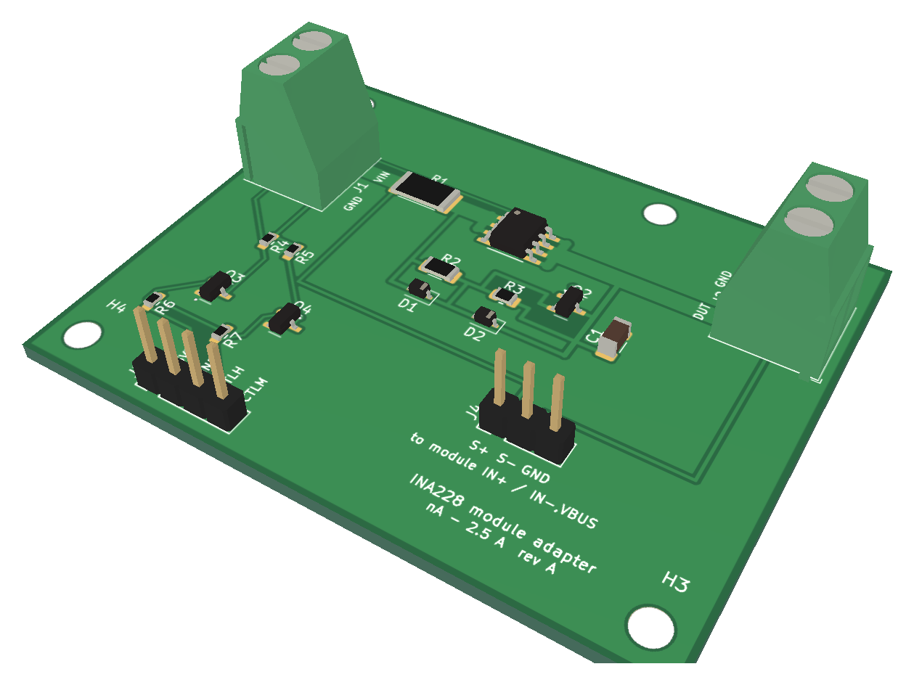

# Variant B: adapter board for an off-the-shelf INA228 breakout

Variant B keeps everything that does the ranging (the three shunts, the two bypass MOSFETs, the clamp diodes, the gate drivers and C1) and leaves out the INA228 itself. You pair it with a ready-made breakout instead.



## Why not just change the module's shunt?

Swapping a breakout's shunt for a single other resistor only moves its window; it does not widen it. With one resistor, the INA228 covers roughly four to five useful decades:

| Single shunt | Full scale (±40.96 mV range) | 1 LSB | Good for |
|---|---|---|---|
| 15 mΩ (stock) | 2.7 A | ≈ 5 µA | run mode |
| 1 Ω | 41 mA | ≈ 78 nA | light run, stop modes |
| 1 kΩ | 41 µA | ≈ 78 pA | deep sleep only |

A single resistor is fine if you only care about one state of the STM32. Going from deep sleep (tens of nA) to full load (up to 2.5 A) needs switched ranges, and that is what this adapter adds.

## How it connects

```
Bench supply ──► J1 (VIN, GND)
                  │  R1 ─ R2 ─ R3 chain, Q1/Q2 range bypass  (on the adapter)
DUT (STM32) ◄─── J2 (DUT, GND)

J4  S+  ──────► module IN+
    S−  ──────► module IN−   (and VBUS)
    GND ──────► module GND

J3  3V3 GND CTL_H CTL_M ──► logger MCU GPIOs
module SDA/SCL/ALERT (Qwiic) ──► logger MCU I2C
```

**No load current flows through the module.** J4 is a Kelvin sense output:

- S+ is taken from the R1 pad.
- S− is taken from the DUT terminal.
- The module only measures the voltage between them, so its own copper and screw terminal add no error.

## Preparing the module

| Module | What to change |
|---|---|
| SparkFun Current Sensor INA228 (Qwiic, SEN-31438) | **Open the SHUNT jumper** on the back. That disconnects the onboard shunt. Leave the custom-shunt holes empty. VBUS is isolated by default: connect the VBUS terminal to S−, or close the VBUS jumper (VBUS = IN+). |
| Adafruit INA228 (5832) | **Remove the 15 mΩ shunt resistor** (hot air or two irons). Connect VBus to S−. |
| Generic INA228 boards | Remove or cut the onboard shunt. Check that nothing else connects IN+ to IN− (input filter resistors in series are fine). |

If the onboard shunt stays connected, it sits directly across S+ and S−. Almost all the current then runs through the sense wires and the module's shunt, and every range reads wrong. Before connecting the sense wires, measure the resistance between the module's IN+ and IN−: it must be high (hundreds of kΩ or more), not milliohms.

## Wiring tips

- Keep the S+ and S− wires short (under 15 cm) and twist them together. They carry no current, so thin wire is fine.
- Keep the sense wires away from the J1–J2 current path.
- The logger, the module and the adapter must share GND.
- For the nA range, keep the module clean (no flux residue). Do the zero calibration with the module connected, because its input bias current is part of the offset.

## Firmware differences from variant A

- **Register access:** the same as variant A, since the module is the same INA228 at 0x40 (SparkFun and Adafruit both default to 0x40; check the address jumpers).
- **Range control:** CTL_H and CTL_M are GPIOs on J3 of the adapter. ALERT comes from the module.
- **Calibration:** the effective shunt now includes the sense wiring only up to the Kelvin points. That makes it more repeatable than variant A, where part of the copper sits inside the measured span.
