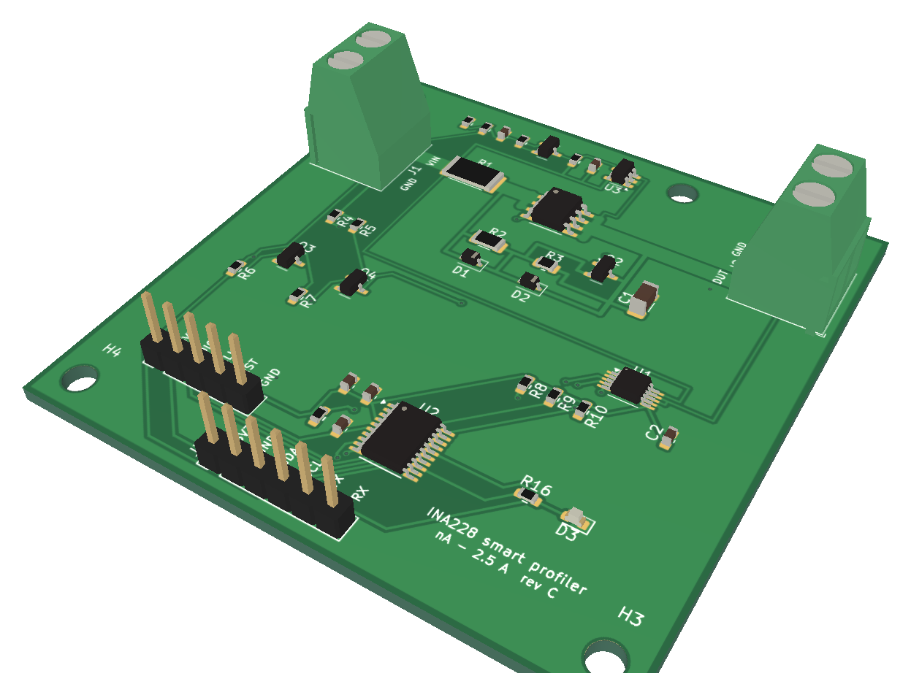

# Variant C: smart profiler (on-board ranging)

Variants A and B leave the range switching to the logger MCU. Variant C puts a small **STM32G030F6P6** and a fast **comparator** on the board, so the host never sees the three ranges. It reads one current in amperes, one voltage and the integrated charge and energy:

- **I2C slave at 0x48** on J3. The current is one `float` at register 0x04.
- **CSV over UART** on J3 at 921600 8N1, one line per conversion: `t_us,current_A,voltage_V,range`.

The measurement core is unchanged from rev A: R1/R2/R3, Q1/Q2, D1/D2, C1, the INA228 and the hand-routed Kelvin traces.



## Block diagram

```
          VIN ──R11 1k──● CMP_REF            U3 TLV7021 (powered from VIN)
           │            │                    IN+ = DUT_VDD   IN- = CMP_REF
           │            Q5 MMBT3904 ~32 µA   OUT (open drain) ──R15── 3V3
           │            sink, base at 1.65 V   │
VIN ──R1──R2──R3── DUT_VDD                     └─► PA0 (EXTI) ─┐
           (Q1, Q2 range FETs as in rev A)                    │
INA228 ── I2C1 (private) ── STM32G030 ◄────────────────────────┘
                              │  PA4/PA5 → CTL_H / CTL_M
                              ├─ I2C2 slave 0x48 ─┐
                              └─ USART2 TX/RX ────┴─ J3: 3V3 GND SDA SCL TX RX
```

## How the ranging works

| Event | Who acts | Latency | What happens |
|---|---|---|---|
| Current step up (DUT wakes up) | U3 → EXTI on PA0 | ≈ 1 µs | One range up; repeated at once while U3 is still tripped |
| Reading > 90 % of ADC full scale | firmware, per conversion | one conversion | One range up (backup for the comparator) |
| Current would give < 15 mV in the next lower range, 8 times in a row | firmware | ≈ 5 ms at the default rate | One range down |

After every switch, two conversions are discarded. Charge and energy keep integrating with the last good current across that gap, so the host's average current stays continuous.

### Comparator threshold

Q5 sinks a fixed current from the reference node, set by its base divider (R13/R14 from 3V3 → 1.65 V) and R12:

  I_sink = (1.65 V − V_BE) / 33 kΩ ≈ (1.65 − 0.60) / 33 k ≈ 32 µA
  V_th   = I_sink × R11 = 32 µA × 1 kΩ ≈ 32 mV

U3 compares DUT_VDD with VIN − V_th. When the drop across the shunt chain exceeds V_th, its output pulls PA0 low. In each range that corresponds to:

| Range | Chain resistance | Trip current (nominal) | Worst case with U3's ±8 mV offset |
|---|---|---|---|
| L | ≈ 990 Ω (with the INA228 input) | ≈ 32 µA | 24 – 41 µA |
| M | ≈ 1.08 Ω | ≈ 30 mA | 22 – 37 mA |
| H | ≈ 0.06 Ω | ≈ 0.5 A | (masked: H is the top range) |

The down threshold (15 mV in the lower range) stays below the lowest possible trip point (24 mV), so the ranges cannot oscillate.

- **Why it doesn't disturb the measurement:**
  - U3 IN+ draws about 5 pA from DUT_VDD.
  - R11, Q5, U3's supply and C5 are all fed from VIN upstream of the shunts, so their current is never measured.
- **Supply range:** VIN must be **1.8 to 5.5 V**. That is U3's supply range, and Q5 needs VIN above about 1.4 V to stay out of saturation. 3V3 for the INA228 and MCU comes from J3.
- **Power-up order:** connect 3V3 (the host) **before** VIN. Without 3V3 the CTL pull-ups have no supply, both FETs turn off, and the DUT sits behind 1 kΩ (range L). That is safe for the board, but the DUT will not start. Variants A and B behave the same.

## Sample rate

The INA228 runs continuously with VBUSCT = 50 µs and VSHCT set by `ct` (default 4 = 540 µs). That gives about **1.7 k samples/s**.

| `ct` | VSHCT | Samples/s (approx.) | UART |
|---|---|---|---|
| 2 | 150 µs | ≈ 4 k | too fast for the CSV stream; use I2C or turn the stream off |
| 3 | 280 µs | ≈ 3 k | at the limit of 921600 Bd |
| 4 | 540 µs | ≈ 1.7 k | default |
| 5 | 1052 µs | ≈ 0.9 k | lower noise |

The INA228 integrates over the whole conversion time, so no charge is lost between samples at any rate.

## Accuracy notes

- **Calibration:** calibrate each range as in [design.md](design.md#calibration).
  - Set R with `cal L|M|H <ohm>` and the offset with `off L|M|H <A>`.
  - Store with `save`.
  - Or write registers 0x30–0x47 and 0x4B = 0xA5 over I2C.
- **Default R_L:** 990.3 Ω. That is R1 + R2 + R3 in parallel with the INA228's ≈ 92 kΩ input, which also carries DUT current.
- **Saving:** a flash write stops the CPU for about 20 ms. Don't save during a measurement.

## Programming

- **Connections:** J4 carries 3V3, SWDIO, SWCLK, NRST and GND. It is not assembled; solder a 1×5 header.
- **Power:** an ST-Link (for example the ST-LINK on a Nucleo board, CN4) does **not** power the board. Supply 3V3 through J3 while programming.
- **Firmware:** see [firmware/smart/README.md](../firmware/smart/README.md).

## Raspberry Pi notes

- **I2C:** the Pi's I2C1 (GPIO2 SDA, GPIO3 SCL) already has 1.8 kΩ pull-ups, so the board has none on the host bus.
- **Clock stretching:** the Pi's I2C controller handles it poorly, and the board stretches the clock briefly on every read. If you get read errors, do one of these:
  - Lower the bus clock: `dtparam=i2c_arm_baudrate=50000` in `/boot/config.txt`.
  - Use the software I2C overlay: `dtoverlay=i2c-gpio,i2c_gpio_sda=2,i2c_gpio_scl=3`.
- **UART:** works at 921600 on `/dev/serial0` once the serial console is disabled.
